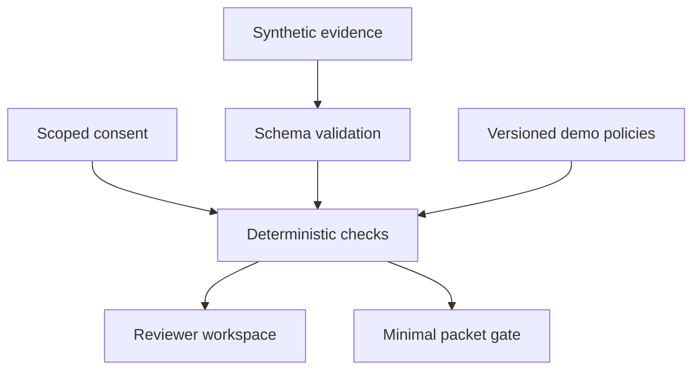

# ClaimWeave

**One record. Every dependency.**

A working policy evidence workbench that makes consent, freshness, conflicting records, and rule changes visible across application checks. Inspired by YC's [Plaid for Government Benefits](https://www.ycombinator.com/rfs) request; built as a focused research prototype, not an agency system.

## Try it

Requires Node.js 22 or newer. No API keys, dependencies, accounts, or installation step.

```sh
npm start
```

Open **http://127.0.0.1:4173**. Run `npm test` for the engine suite and `npm run build` to validate static assets and regenerate the sample import fixture. Serve `dist/` from any static host for a shareable demo.

## A two-minute demonstration

1. Inspect the initial workspace: three synthetic records feed six checks across three fictional programs.
2. Select Housing bridge. Download its minimal packet: income and city are present; account numbers and street addresses are absent.
3. Withdraw housing consent. Housing exports stop while transit and learning checks continue.
4. Reset the demo. Open Change simulator, run the competing-payroll scenario, and apply it. The engine refuses to resolve two conflicting current values automatically.
5. Reset, then compare an income-cap change. The same record passes the original fictional rule and fails the modified rule, with the changed check displayed.
6. Move the evaluation date forward to see which evidence becomes stale. Use `docs/demo-fixture.json` to demonstrate validated imports.

## What is implemented

- Pure JavaScript engine shared between browser and tests; no network requests.
- Per-program, per-purpose, field-scoped consent and expiration.
- Freshness rules, future-date rejection, current-record conflict detection, explicit missing-data states.
- Policy version comparisons and controlled evidence scenarios.
- Allowlist-only evidence packet downloads, gated by current checks and consent.
- Responsive UI, labelled inputs, keyboard-accessible native controls, live status messages.
- JSON fixture import with validation and file-size limits; session-only event trail.
- Regression tests and GitHub Actions verification.

## Architecture



The UI is a static ES-module application. `dist/engine.js` is framework-independent and has no DOM or I/O dependencies. `server.mjs` is a loopback-only development server with an asset allowlist and restrictive headers. State stays in browser memory and resets on reload. A packet is reconstructed from explicit fields; source objects are never serialized wholesale.

## Research and originality

Reusable benefits verification is an existing category. ClaimWeave explores a compact evidence-dependency and policy regression workflow. See [the research comparison](docs/RESEARCH.md), including competing products, open-source projects, hackathon entries, and a limited patent search. This research does **not** establish patent novelty or prove no similar project exists.

## Scope and limitations

All programs, rules, connectors, and applicant records are fictional. No live payroll or government integrations, actual eligibility decisions, identity verification, OCR, cryptographic proofs, backend access controls, or production audit log. Browser imports are for synthetic data only. Consent withdrawal gates future downloads in this prototype; it does not erase copies previously exported. Real records require a separate security, legal, accessibility, and domain-validation process. Evaluation statuses describe demonstration checks only.

There is no runtime AI in this version. OpenAI Codex was used for research, coding, UI design, tests, and documentation. Do not describe the deterministic rules engine as a trained model. The project is not affiliated with or endorsed by YC, CMS, Reclaim, or any government agency.

## Hackathon provenance

Implementation began November 8, 2026. No pre-existing competitor code was copied. Disclose AI assistance and the specific human contributions in any submission. Registration and submission are separate actions; this repository does not imply either has occurred. See [the submission draft](docs/SUBMISSION.md).
